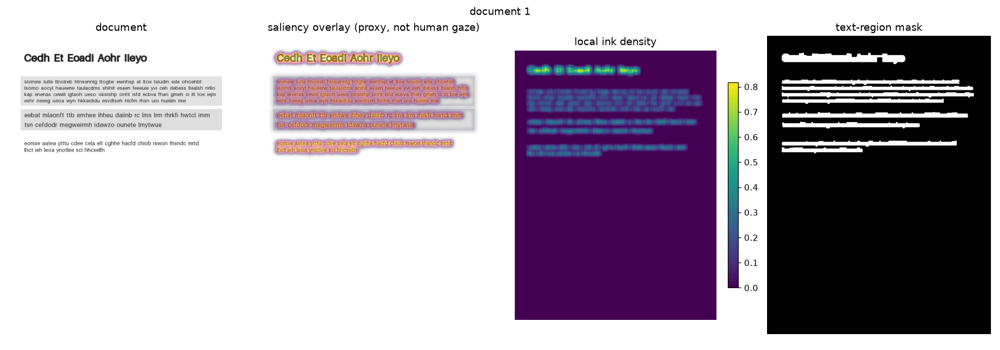
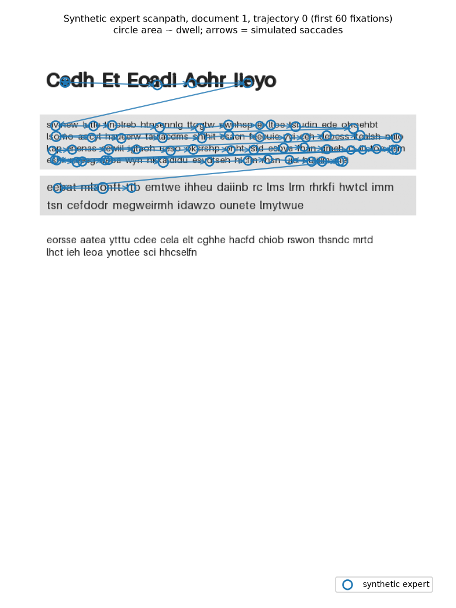
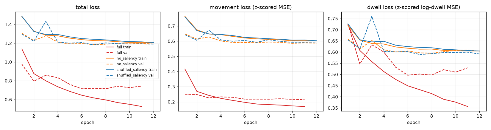
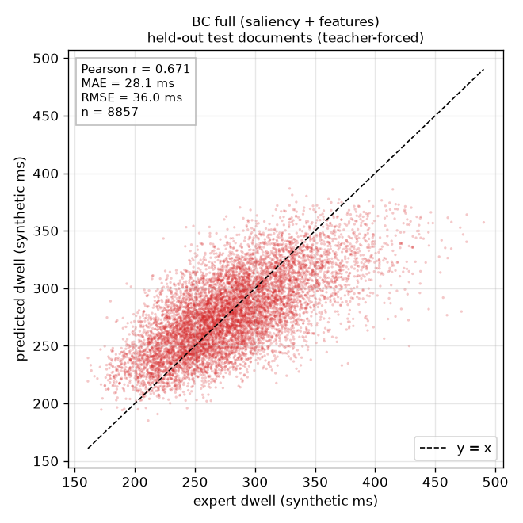
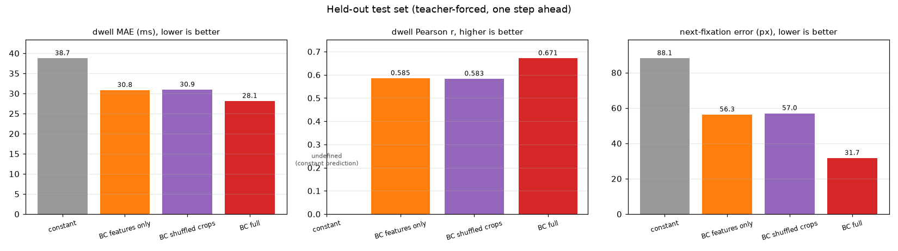
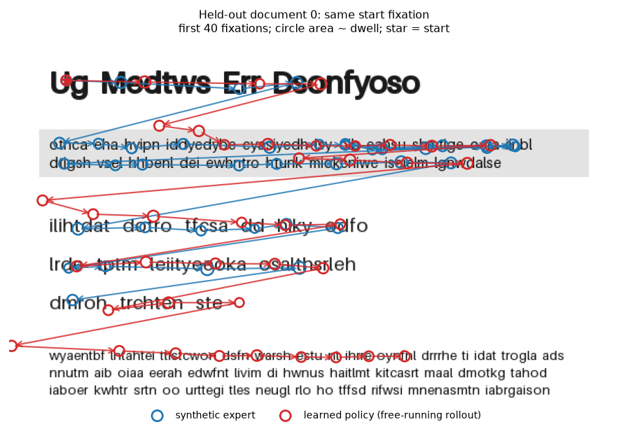
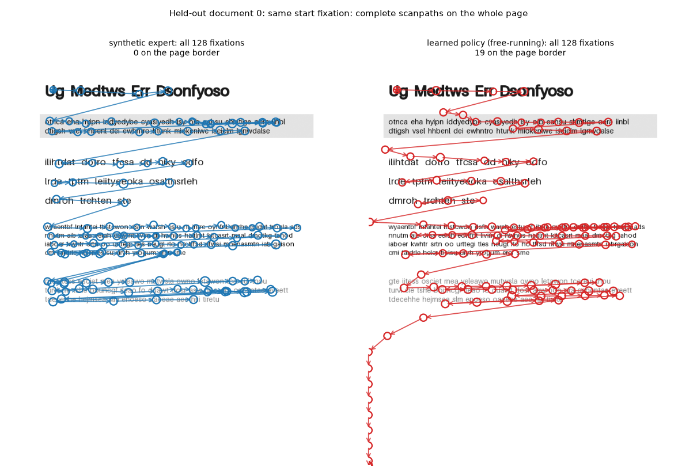
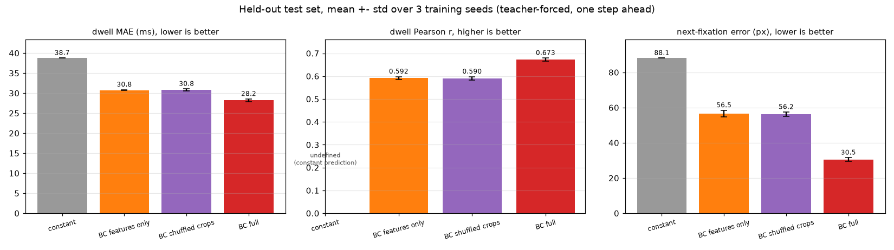
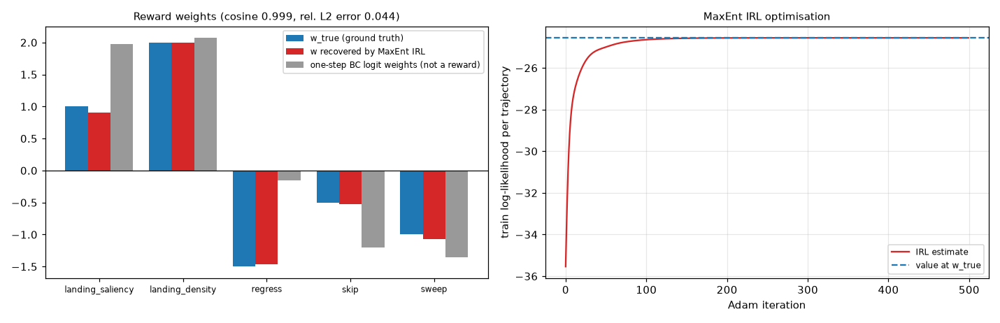
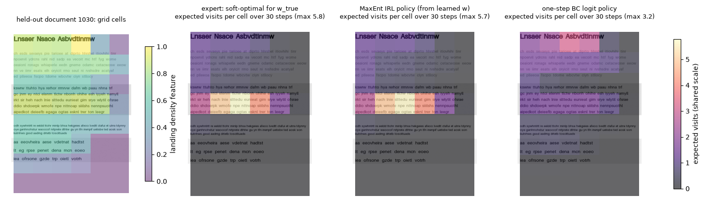

# Visual Attention Modeling for Imitation Learning: A Lightweight Simulation of Reading Behavior

A small, fully working research project. A PyTorch policy learns, by **Behavior Cloning (BC)**,
to imitate a **synthetic, rule-based reading expert**. The policy predicts where the gaze moves next
and how long each fixation lasts (dwell time). Its inputs are a handcrafted saliency map and local
visual features of synthetic text documents. A separate, small **Maximum-Entropy IRL** experiment
recovers a known reward function from demonstrations on a discretized version of the same pages.
Everything runs on a CPU in a few minutes.

> **Scope warning.** All "gaze" data in this repository comes from a synthetic expert written in
> code (`src/visual_attention/expert.py`). No human eye-tracking data is used. Agreement with this
> expert says nothing, on its own, about agreement with human readers.

## Quick start

```bash
# Windows (Python 3.11). On Linux/macOS use: source .venv/bin/activate
py -3.11 -m venv .venv
.venv\Scripts\activate
pip install torch==2.14.1 --index-url https://download.pytorch.org/whl/cpu
pip install -r requirements.txt
pip install -e .
python -m pytest -q
python scripts/reproduce_results.py --clean
```

`reproduce_results.py --clean` deletes `data/`, `checkpoints/` and `results/`, then regenerates
the data, trains the three BC variants (full, features only, shuffled-crop control) with training
seed 0, evaluates them on held-out documents, runs the IRL experiment and writes all metrics and
figures. It measured **308.1 s** on the development machine (Windows 11, CPU only, 16 logical cores,
PyTorch using 8 threads): 8.2 s data, 262.2 s BC training and evaluation, 37.8 s IRL. Every run
writes its timing to `results/logs/reproduce_timing.json`, so that file holds the most recent run.
The seed-0 metrics of this quick run were identical to those of the full run below.

Everything in this README, including the three-seed summary and every image in `docs/figures/`, comes
from one run of

```bash
python scripts/reproduce_results.py --clean --seeds 0 1 2 --copy-figures
```

It measured **1039.4 s** (7.3 s data, 977.5 s BC for three seeds, 54.3 s IRL). Totals varied by
about 10 % between runs on the same machine.

Individual stages:

```bash
python scripts/generate_data.py                    # documents + expert demonstrations + split
python -m visual_attention.train --variant full    # `python -m` needs the `pip install -e .` step
python -m visual_attention.train --variant no_saliency
python -m visual_attention.train --variant shuffled_saliency
python -m visual_attention.evaluate                # metrics + figures for existing checkpoints
python -m visual_attention.evaluate --splits val   # validation only (use this while developing)
python scripts/run_experiments.py --skip-train --skip-irl   # re-evaluate existing checkpoints
python scripts/run_experiments.py --seeds 0 1 2 --skip-irl   # three training seeds, mean +- std
python -m visual_attention.irl                     # only the IRL experiment
```

Training flags: `--epochs --lr --batch-size --seed --device --checkpoint-dir --results-dir`. For
example, to experiment without overwriting the checkpoint behind the reported numbers:
`python -m visual_attention.train --variant no_saliency --epochs 10 --lr 3e-4 --device cpu --checkpoint-dir scratch/ckpt --results-dir scratch/results`.
Any config value can be overridden without editing code, e.g.
`python scripts/generate_data.py --set document.n_documents=40 expert.trajectories_per_document=3 paths.data_dir=scratch/data paths.results_dir=scratch/results`
(without the `paths.*` overrides it would overwrite `data/`, which the reported checkpoints were trained on).

## 1. Problem statement

Reading is a sequence of fixations (the eye rests on a word) and saccades (fast jumps between
fixations). Fixation durations depend on what is being looked at. This project builds a controlled,
fully synthetic testbed for one question: can a small neural policy, given only what is visible
around the current gaze point, imitate a reading strategy's **next gaze movement** and its
**dwell time**?

## 2. Research question

Given demonstrations from a known synthetic reading expert:

1. How well does a BC policy predict held-out dwell times (Pearson r, MAE, RMSE) and next
   fixations (Euclidean error), compared with a constant baseline?
2. Does the saliency-map input matter, compared with a model that only gets scalar features
   (saliency ablation)?
3. When the policy runs on its own (free-running rollout), does it still produce reading-like
   scanpaths?

## 3. Scope and non-goals

Implemented (P0): synthetic documents, handcrafted saliency, reading environment, rule-based expert,
demonstration dataset with document-level splits, two-headed BC policy, training with validation
checkpointing, held-out evaluation, constant and feature-only baselines, saliency ablation with a
shuffled-crop control, free-running rollouts, scanpath figures, tests.

Implemented (P1): MaxEnt IRL on a small discretized reading MDP with a **known** ground-truth reward
(reward recovery, derived policy, held-out evaluation, one-step BC comparison). It is kept fully
separate from the BC pipeline. The neural BC model is **not** an IRL agent.

Implemented (P2, partial): three training seeds with mean ± std for the main BC metrics. The other P2
items (better saliency, more IRL features, interactive visualisation) were not done.

Non-goals: real eye-tracking, a validated model of human eye movements, language understanding (the
words are random letter strings), pretrained vision models, web apps, large hyperparameter searches.

## 4. Environment and state representation

* Page: 600 x 800 px grayscale. Gaze `(x, y)` is normalised to [0, 1]² (`x = column/600`,
  `y = row/800`, origin top-left). Pixels are used only for drawing and for reporting errors in px.
* **Observation** at fixation t (a function of the page and the current gaze only):

  | tensor | shape | range | content |
  |---|---|---|---|
  | `saliency` | `1 x 84 x 84` | [0, 1] | saliency map window centred on the gaze, covering 300 x 200 px of the page (zeros outside the page) |
  | `features` | `7` | [0, 1] before z-scoring | `x, y`, and window means (40 x 16 px) of saliency, ink density, local contrast, edge strength, text-mask occupancy |

  Features are z-scored with training-set statistics. The expert's next fixation, future dwell and
  noise-free dwell are stored in the dataset as targets/analysis fields only; they are never inputs.
* **Action:** displacement `(dx, dy)` (normalised units) plus the current fixation's dwell
  (synthetic ms). Transition: `g' = clip(g + (dx, dy), 0, 1)`.
* **Termination:** after a fixed number of steps (rollouts use the length of the matching expert
  trajectory); the expert itself stops at the last word or after 300 fixations.

## 5. Saliency generation

Deterministic OpenCV/NumPy pipeline, no learned model (`saliency.py`):

```
contrast = local std (Gaussian σ=3) / 127.5          edges = |Sobel| / (4·255), smoothed (σ=2)
saliency = minmax( Gauss_σ=4( 0.5·contrast + 0.5·edges ) )        ∈ [0, 1]
ink      = adaptive threshold (25 gray levels below the 25x25 local mean)
density  = 15x15 box mean of ink                   text_mask = closing(ink, 15x5) then 3x3 dilation
```

Constant or blank images give all-zero maps (no NaNs). **Handcrafted saliency is a proxy for visual
prominence. It is not ground-truth human gaze.** A visible artifact: the edges of the gray
background boxes are also salient, although they contain no text. Saliency (prominence) and ink
density are kept as separate features. Note what "density" measures: the local fraction of dark
pixels. It tracks font size and stroke weight, not how much text a paragraph holds. Measured on
documents 0-29, the mean density inside word boxes is 0.214 for dense high-contrast paragraphs,
0.250 for sparse ones and 0.425 for the bold heading. Low contrast barely changes it (0.179 vs 0.214
for dense paragraphs) but halves saliency (0.31 vs 0.61).



## 6. Expert demonstration-generation rules

The expert (`expert.py`) knows the word boxes in reading order. At a fixation on word `i`:

1. Stop at the last word (or after 300 fixations).
2. **Regression** with probability `0.04 + 0.10·(1 − contrast_i)`: go back 1-3 words (not before the
   start of the previous line), then continue reading forward from there.
3. Else at the end of a line: **return sweep** to the first word of the next line.
4. Else **next word**, or **skip** it with probability `p·(1 − 0.5·saliency_next)`
   (`p = 0.45` for words of ≤ 3 letters, `0.04` otherwise).

Landing point: 40 % ± 12 % into the target word horizontally, line centre ± 15 % of line height vertically.

**Dwell (synthetic milliseconds):**

$$\text{clean}_i = 140 + 18\,n^{\text{chars}}_i + 120\,\text{density}_i + 100\,(1-\text{contrast}_i),\qquad
\text{dwell}_i = \max\!\big(80,\ \text{clean}_i\, e^{\varepsilon}\big),\ \varepsilon\sim\mathcal N(0, 0.10^2)$$

The noise level was fixed before any model was trained. The noise is invisible to every model, so
`corr(clean, dwell)` on the test set (**0.807**) is a ceiling for any predictor. Word length is the
largest source of variation (18 ms per letter).

Example (training document 1, first expert trajectory; circle area ∝ dwell):



## 7. Behavior Cloning architecture and objective

```
saliency 1x84x84 → Conv5x5(16,s2) → Conv3x3(32,s2) → Conv3x3(32,s2) → flatten 32·11·11 → FC128 ┐
features 7       → FC64                                                                         ┴→ concat
→ FC128 → Dropout 0.1 → FC128 ─┬→ movement head FC2  (z-scored dx, dy)
                               └→ dwell head    FC1  (z-scored log dwell)
```

(ReLU after every hidden layer; 552,163 parameters.) The feature-only variant builds no CNN at all
(25,731 parameters). The shuffled-crop control has exactly the full architecture (552,163
parameters) and training. Each transition is paired with the real saliency crop of a *different*,
randomly chosen transition of the same split (a fixed permutation). Its input therefore has the
statistics of real crops but carries no information about the current gaze.

Targets: `z_m = (d − μ_d)/σ_d` per axis and `z_w = (log w − μ_log)/σ_log`, using training-split
statistics. Inverse: `w = exp(z_w σ_log + μ_log) > 0`. Loss:

$$\mathcal L = \lambda_m \,\mathrm{MSE}(\hat z_m, z_m) + \lambda_w\, \mathrm{MSE}(\hat z_w, z_w),\qquad \lambda_m=\lambda_w=1$$

Both targets are z-scored, so neither term dominates because of units. The dwell head is
separate because dwell depends mainly on the fixated word, while movement depends on the layout
around it. Both heads share the encoder.

## 8. IRL method (separate experiment, `irl.py`)

The rule-based P0 expert has no reward function, so it cannot be used to test reward recovery.
The IRL experiment therefore uses its own expert, which is soft-optimal for a **known** reward:

* **MDP:** the page inside the margins becomes an 8 x 6 grid of cells (reading order). The episode
  starts in the top-left cell and lasts T = 30 steps. Actions: `right`, `skip` (2 cells),
  `regress` (1 cell back), `sweep` (start of next row); moves off the grid are masked. Pages are new
  synthetic documents (ids 1000-1044: 30 train, 15 test), disjoint from the BC documents.
* **Reward:** $R(s,a) = w^\top\phi(s,a)$ with
  $\phi = [\text{saliency}(s'), \text{density}(s'), 1_{\text{regress}}, 1_{\text{skip}}, 1_{\text{sweep}}]$,
  where $s'$ is the landing cell (cell means of the P0 maps, scaled to [0, 1] per page).
  Ground truth: $w_{\text{true}} = [1.0, 2.0, -1.5, -0.5, -1.0]$.
* **Expert:** finite-horizon soft value iteration,
  $Q_t(s,a) = R(s,a) + V_{t+1}(s')$, $V_t(s) = \log\sum_a e^{Q_t(s,a)}$,
  $\pi_t(a|s) = e^{Q_t(s,a) - V_t(s)}$. 20 trajectories are sampled per page.
* **MaxEnt IRL:** maximise the demonstration log-likelihood $\log P(\tau|w) = w^\top\Phi(\tau) - V_0(s_0)$
  (concave). Its exact gradient is
  $\nabla_w = \overline{\Phi}_{\text{expert}} - \mathbb E_{\pi_w}[\Phi]$, the expert feature counts
  minus the learner's expected feature counts. The expected counts come from a forward pass over
  state-visitation frequencies. Adam gradient ascent runs for 500 iterations from $w = 0$. The policy is
  then derived from the learned reward by soft value iteration.
* **Baseline:** one-step BC on the same features (conditional logit $\pi(a|s)\propto e^{\theta^\top\phi(s,a)}$,
  maximum likelihood, no planning), plus a uniform policy over legal actions.

This is recovery of a *synthetic expert's* reward. It does not infer a reward used by human readers.

## 9. Dataset generation and split strategy

* 100 documents x 5 expert trajectories = 500 trajectories, **59,616 transitions** (`t → t+1`).
* Stored in `data/processed/transitions.npz` (schema in `dataset.py`); documents in `data/raw/`
  as PNG + JSON layout.
* Split **by document id** (seeded permutation): 70 train / 15 val / 15 test documents (40,963 /
  9,796 / 8,857 transitions). Saved in `data/processed/splits.json` and checked to be disjoint on
  every load. Whole trajectories therefore stay in one split.

## 10. Training

AdamW (lr 1e-3, weight decay 1e-4), batch 256, at most 30 epochs, early stopping (patience 5) on
validation loss, best-validation checkpoint saved to `checkpoints/<variant>_seed<k>/best.pt`.
Per-epoch losses go to `results/logs/train_<variant>_seed<k>.csv`, and the effective config is saved
next to every checkpoint. Python, NumPy and PyTorch are seeded. The device is chosen automatically
(CUDA → MPS → CPU) or forced with `--device`. Measured on CPU (seed 0,
`checkpoints/*_seed0/train_summary.json`): the full model stopped after 11 epochs (best epoch 6) in
116.2 s; the feature-only model after 12 epochs (best 7) in 6.6 s; the shuffled-crop control after
12 epochs (best 7) in 128.7 s.



## 11. Evaluation metrics

* **Dwell** (teacher-forced, held-out test documents): Pearson r between predicted and expert dwell,
  MAE and RMSE in synthetic ms, R². Pearson r is reported as `null`/"undefined" when an input is
  constant (e.g. for the constant baseline). It is a correlation, not a percentage accuracy.
* **Movement** (teacher-forced): mean Euclidean error between predicted and expert next fixation,
  in normalised units and in pixels (`sqrt((600Δx)² + (800Δy)²)`), broken down by saccade type,
  plus the fraction of predicted next fixations that land on the text mask.
* **Free-running rollout:** from the first fixation of expert trajectory 0 on each test document,
  the policy moves using only its own outputs for the same number of steps as the expert. Layout is
  used for scoring only: fraction of fixations on text, fraction of words fixated (word coverage),
  fraction of lines visited, and fraction of steps clipped at the page border.

Matching the expert's next fixation does not mean matching a human reader.

## 12. Baselines and ablations

* **Baseline A, constant:** training-set mean dwell (284.5 ms) and mean displacement for every
  test example. It does not use validation or test labels (there is a unit test for this).
* **Baseline B = saliency ablation:** identical training, same splits and metrics, but the model has
  no saliency map/crop and no CNN. The 7 scalar features, which include the window-mean saliency,
  are kept.
* **Shuffled-crop control:** the full architecture (21x more parameters than Baseline B) and the full
  training, fed real saliency crops taken from other, random transitions. It separates "the crop
  aligned with the gaze carries information" from "a bigger network, or crop-like input statistics,
  helps". (An earlier version fed an all-zero image. The second review pointed out that a constant
  input only adds a bias, so that control could not test anything. It was replaced.)
* **Noise-ceiling reference:** the expert's own noise-free dwell rule scored like a model. It uses
  hidden variables, so it is a reference, not a competitor.

## 13. Results (measured, seed 0, held-out test set: 15 documents, 8,857 transitions)

Teacher-forced, one step ahead:

| model | dwell Pearson r | dwell MAE (ms) | dwell RMSE (ms) | dwell R² | next-fixation error (px) | error (norm.) | predicted next fixation on text |
|---|---|---|---|---|---|---|---|
| constant baseline | undefined | 38.7 | 48.6 | −0.006 | 88.1 | 0.146 | 79.2 % |
| BC features only (ablation) | 0.585 | 30.8 | 39.5 | 0.334 | 56.3 | 0.093 | 78.2 % |
| BC shuffled-crop control | 0.583 | 30.9 | 40.0 | 0.319 | 57.0 | 0.094 | 74.3 % |
| **BC full (saliency + features)** | **0.671** | **28.1** | **36.0** | **0.447** | **31.7** | **0.052** | **92.1 %** |
| *noise ceiling (reference)* | *0.807* | *22.5* | *28.7* | *0.650* | – | – | – |

Validation split (15 other documents, 9,796 transitions): full r = 0.699, MAE 27.4 ms, 30.1 px;
features only 0.621 / 30.3 ms / 55.3 px; shuffled-crop control 0.624 / 30.0 ms / 56.0 px; constant
39.1 ms / 87.8 px; noise ceiling r = 0.813.

Next-fixation error (px) by saccade type (test counts in brackets):

| model | forward (6,559) | skip (715) | regression (560) | return sweep (1,023) |
|---|---|---|---|---|
| constant | 45.2 | 74.6 | 139.4 | 344.3 |
| features only | 29.8 | 39.3 | 148.9 | 186.8 |
| shuffled-crop control | 34.1 | 43.4 | 151.8 | 161.6 |
| full | 17.2 | 24.1 | 166.6 | 56.0 |

Free-running rollouts (mean over the 15 test documents; the shuffled-crop control has no meaningful
free-running version, because its input is not tied to its own gaze):

| scanpath | fixations on text | words fixated | lines visited | steps clipped at border |
|---|---|---|---|---|
| synthetic expert | 98.4 % | 91.9 % | 100 % | – |
| BC full | 63.7 % | 60.8 % | 90.4 % | 17.8 % |
| BC features only | 35.9 % | 34.5 % | 89.7 % | 10.3 % |
| constant | 30.3 % | 11.4 % | 88.0 % | 0 % |




First 40 fixations (left) and the complete rollout on the whole page (below) for held-out document 0:




**Interpretation.**

* The full model beats all baselines on every teacher-forced metric except regressions. **The
  held-out dwell correlation is 0.671, not 0.85.** The resume claim of "85% correlation" is **not
  reproduced** by this setup. The ceiling set by the synthetic noise is 0.807. Pearson r is a
  correlation, not "85 % accuracy".
* Removing saliency hurts movement most (31.7 → 56.3 px). Return sweeps go from 56.0 to 186.8 px,
  because the crop shows where the line ends and where the next line is. Dwell also gets worse
  (r 0.671 → 0.585). The scalar features carry contrast and ink density. Word length, the largest
  dwell factor, is only weakly present in them: a linear fit of word length on the 7 features gives
  R² = 0.28 on the test transitions. The crop shows word extent directly.
* **The gain is not just capacity or input statistics:** the same 552k-parameter network trained on
  real crops from *other* transitions does no better than the small feature-only model (r 0.583,
  57.0 px). The improvement needs the crop at the current gaze.
* Regressions are random in the expert, so no model predicts them. The full model is worse than the
  constant baseline on them (166.6 vs 139.4 px), because it confidently predicts the usual forward move.
* Rollouts show **compounding error**. The learned policy reads left to right with return sweeps for
  a while, but it often skips lines and runs out of text before the step budget ends. It then drifts
  into blank page areas never seen in training and ends at the bottom-left corner (17.8 % of steps
  clipped). The 40-fixation figure hides this; the full-rollout figure shows it. Line coverage is a
  weak metric: even the constant policy, drifting slowly downward, crosses 88 % of lines. Word
  coverage separates the methods much better.
* Dwell predictions shrink toward the mean (see the scatter), as expected for MSE regression
  with r ≈ 0.67.

### Training-seed variability (P2: seeds 0, 1, 2; same data, splits and test set)

Produced by the `--seeds 0 1 2` run above → `results/metrics/multiseed_summary.{json,csv}`.
Only the training seed (initialisation, batch order, dropout) changes. Mean ± sample std over 3 seeds:

| model | dwell r | dwell MAE (ms) | dwell RMSE (ms) | next-fixation error (px) |
|---|---|---|---|---|
| constant | undefined | 38.75 ± 0 | 48.58 ± 0 | 88.08 ± 0 |
| BC features only | 0.592 ± 0.006 | 30.75 ± 0.09 | 39.56 ± 0.04 | 56.52 ± 1.84 |
| BC shuffled-crop control | 0.590 ± 0.007 | 30.81 ± 0.22 | 39.74 ± 0.27 | 56.22 ± 1.17 |
| **BC full** | **0.673 ± 0.006** | **28.19 ± 0.32** | **36.23 ± 0.56** | **30.55 ± 0.97** |

Per seed, full-model dwell r = 0.671 / 0.667 / 0.680. The ranking full > {features only ≈ shuffled
crops} > constant holds for every seed. Rollouts vary much more between seeds: the share of fixations on text is
73.0 ± 8.2 % (full) vs. 28.6 ± 8.0 % (features only), and the share of steps clipped at the border is
10.7 ± 6.1 % (full). Three seeds give only a rough spread estimate; they are not a confidence interval
over documents.



### IRL results (held-out pages 1030-1044; 30 training pages × 20 trajectories)

| | landing saliency | landing density | regress | skip | sweep |
|---|---|---|---|---|---|
| $w_{\text{true}}$ | 1.000 | 2.000 | −1.500 | −0.500 | −1.000 |
| $w$ recovered by MaxEnt IRL | 0.902 | 2.001 | −1.463 | −0.522 | −1.071 |

Cosine similarity **0.999**, relative L2 error **0.044**. Both meet the success criterion fixed in advance
(cosine ≥ 0.99, relative error ≤ 0.15). The final gradient norm was 5.9e-5, and the training
log-likelihood at the estimate (−24.554 per trajectory) is slightly *above* its value at $w_{\text{true}}$
(−24.560), as expected for a maximum-likelihood estimate.

| policy on held-out pages | NLL per step | TV distance to true policy | argmax agreement | expected true return |
|---|---|---|---|---|
| true reward, soft-optimal (reference) | 0.8251 | 0 | 100 % | 54.82 |
| **MaxEnt IRL (derived from learned $w$)** | **0.8253** | **0.006** | **99.3 %** | **54.68** |
| one-step BC logit (same features) | 0.9197 | 0.140 | 78.3 % | 44.56 |
| uniform over legal actions | 1.2958 | 0.404 | 46.2 % | 7.65 |

Feature expectations on held-out pages (per 30-step episode), empirical expert demonstrations vs.
the IRL policy: saliency 25.02 vs 24.99, density 25.34 vs 25.36, regress 10.94 vs 11.05, skip 2.69
vs 2.71, sweep 3.15 vs 3.10.

Data-size sweep: nested subsets, the first 1 or 5 of the 20 trajectories per training page (n = 20 is
the main run). 1 trajectory/page gives cosine 0.998 (relative error 0.068); 5 give 0.996 (0.095);
20 give 0.999 (0.044). There is a single sample at each size, so the 1-vs-5 ordering is noise.
Extra demonstration seeds, run by the second reviewer, gave cosine ≥ 0.999 and relative error ≤ 0.053.




**Interpretation.** The IRL code recovers the generating reward and its derived policy generalises to
new pages almost as well as the true policy.

* **The comparison with one-step BC is structurally favourable to IRL.** IRL is given the exact
  dynamics, the horizon and the start state, and the expert is inside its model class. The BC logit
  is stationary and myopic. Its worse held-out NLL shows that BC is mis-specified for a planning
  expert. It is not evidence that IRL is generally better.
* **The success criterion is lenient.** Even 1 trajectory per page clears it.
* **The saliency weight has the largest error (0.098).** Cell saliency and cell density are strongly
  collinear (r = 0.88 over the cells of held-out page 1030; 0.96 pooled over all training cells), which makes their weights harder to
  separate.
* **The grid expert is not a realistic reader.** The memoryless reward makes it oscillate over dense
  cells (about 11 regressions per 30 steps).

This checks the method and the code, not a hypothesis about reading.

## 13b. Resume claims vs. evidence

| claim (as worded on the resume) | what the code actually does | verdict |
|---|---|---|
| "Developed an IRL agent that mimics human gaze patterns by processing visual saliency maps as state inputs." | MaxEnt IRL is implemented and recovers a known reward (cosine 0.999). Its states are cells of an 8 x 6 grid with two scalar cell features (saliency, density). It does not take saliency *maps* as input, and its demonstrations come from a synthetic soft-optimal agent. No human gaze is used anywhere. The model that takes saliency maps as input is the BC policy, not the IRL agent. | **Not supported as worded.** Defensible version: "Implemented MaxEnt IRL that recovers a known reward over saliency/density features of document regions (cosine 0.999 on held-out pages) in a synthetic reading MDP." |
| "Trained a policy using Behavior Cloning to predict dwell time based on visual feature complexity, achieving 85% correlation with expert demonstrations." | BC two-headed policy; held-out dwell Pearson r = 0.671 (seed 0), 0.673 ± 0.006 over 3 seeds, against a synthetic rule-based expert. The ceiling set by the synthetic noise is 0.807. | **Number not reproduced.** Also, "85 % correlation" mixes a percentage with a correlation. Defensible version: "...reaching Pearson r = 0.67 on held-out documents (noise ceiling 0.81), vs. 0.59 without the saliency map." |
| "Simulated saccadic movements to model how agents shift attention across high-density information regions, analogous to human reading behaviors." | The expert and the learned policy produce saccade sequences (forward moves, skips, regressions, return sweeps). The learned policy reads left to right in rollouts but drifts off the text (64 % of rollout fixations on text vs. 98 % for the expert). Nothing is compared with human data. "Density" here is ink density, which tracks font weight more than information content. | **Supported only as a simulation** ("computational analogy"); no human-likeness is shown. |

## 14. Limitations and threats to validity

* **Synthetic expert, synthetic noise.** All targets come from rules written in this repository. The
  dwell correlation depends directly on the chosen noise level (σ = 0.10) and on how visible the dwell
  factors are in the input. It can be made arbitrarily high or low by changing the generator, so the
  number only means something relative to the baselines and the noise ceiling.
* **No human data.** Nothing here validates the model, or the expert, against real readers.
* **Expert knows the layout; the model sees pixels.** The expert uses word boxes; the policy must infer
  them from a blurred saliency crop. Some error is caused by this information gap, not by learning.
* The main tables use training seed 0. Three seeds are summarised separately. The test set has only
  15 documents, and seeds do not capture variation across document sets.
* **MSE regression of a multimodal action.** Skips and regressions are random. The conditional mean
  is not a valid sample of reading behaviour.
* **BC covariate shift** in rollouts, as seen above. No DAgger-style correction is implemented.
* **IRL is a controlled toy.** It runs on a 48-cell grid with a soft-optimal expert whose reward is in
  the model class. It was not run on the rule-based P0 expert (that expert has no reward to compare
  against) and it is not connected to the continuous gaze policy.
* Development choices (no CNN pooling; 100 documents × 5 trajectories) were made on the
  **validation** split, for the full model only (raw logs: `docs/development_log.md`). The test split
  was evaluated only after they were fixed. The feature-only model was not tuned separately.
* Remaining nondeterminism: independent clean reruns on the development machine (CPU) reproduced
  the predictions CSV, the summary CSVs, the transitions and the splits byte for byte. The JSON
  metric files were identical apart from wall-clock `seconds` fields and absolute checkpoint paths.
  Other PyTorch/BLAS builds or GPUs may change the last digits.

## 15. Reproducibility

* One command for the seed-0 results and IRL: `python scripts/reproduce_results.py --clean` (308.1 s
  measured, CPU). Everything, including the three-seed summary and the README figures:
  `python scripts/reproduce_results.py --clean --seeds 0 1 2 --copy-figures`. `--clean` only deletes
  output directories that lie inside the project folder.
* Config: `configs/default.yaml` (seed, document generation, dataset size, map sizes, split, model,
  training, output paths, evaluation and IRL settings). The effective config is saved with every
  checkpoint (`checkpoints/*/config.yaml`), evaluation (`results/metrics/eval_config_seed*.yaml`) and run
  (`results/logs/run_config.yaml`).
* IRL: `results/metrics/irl_results.json` (weights, recovery, held-out metrics, sweep) and
  `results/logs/irl_optimization.csv` (log-likelihood, gradient norm and `w` at every iteration).
* All test-set predictions: `results/metrics/predictions_test_seed0.csv`. The reported metrics can
  be recomputed from that file with `visual_attention.evaluate.metrics_from_predictions_csv`
  (covered by a unit test).
* Exact package versions: `requirements.txt` (Python 3.11.9).
* `data/`, `checkpoints/` and `results/` are git-ignored. `docs/figures/` holds copies of figures
  produced by a real run of `python scripts/reproduce_results.py --clean --seeds 0 1 2 --copy-figures`.
* `seed` (training, IRL demonstrations) and `data_seed` (documents, expert trajectories, split) are
  separate config keys, so a saved config always regenerates the same data.

## 16. Directory structure

```
visual-attention-imitation/
├── configs/default.yaml           all settings
├── src/visual_attention/
│   ├── config.py                  YAML loading/overrides, seeding, device choice
│   ├── document_generator.py      synthetic pages + layout
│   ├── saliency.py                handcrafted saliency / density / text mask
│   ├── environment.py             gaze state, observation (crop + features), transitions
│   ├── expert.py                  rule-based reading expert and dwell rule
│   ├── dataset.py                 demonstrations, storage, document split, torch Dataset
│   ├── model.py                   two-headed BC policy, loss, checkpoints
│   ├── train.py                   training loop (CLI)
│   ├── evaluate.py                metrics, baselines, rollouts (CLI)
│   ├── visualize.py               figures
│   └── irl.py                     grid MDP, soft value iteration, MaxEnt IRL, one-step BC logit (CLI)
├── scripts/  generate_data.py  run_experiments.py  reproduce_results.py  dev_validation_run.py
├── tests/    unit and integration tests (pytest)
├── docs/     methodology.md  experiments.md  interview_notes.md  development_log.md  final_report.md  figures/
├── data/  checkpoints/  results/  (generated, git-ignored)
```

## 17. Design choices (interview-level)

* **Why BC as the baseline learner?** It is the simplest imitation method: supervised regression
  from state to expert action. It needs no reward and no environment interaction during training,
  and it shows clearly what can be learned from demonstrations alone. Its known weakness (compounding
  error off the expert's state distribution) is visible in the rollouts.
* **Why synthetic demonstrations?** The generating rules are known, so the experiment is controlled:
  we know which factors drive dwell, we can compute a noise ceiling, and leakage is easy to rule out.
  The price is that success says nothing about humans.
* **Why a gaze-centred crop instead of the whole-page map?** The decisions are local (which word am
  I on, where does the line end). A crop makes the input translation-invariant and lets a small CNN
  see the relevant layout. A whole-page map plus coordinates would force the network to learn a
  spatial lookup.
* **Why two heads?** Dwell and movement are different quantities with different units and
  different determinants. Separate heads with z-scored targets keep their losses comparable.
* **Why log-dwell?** Durations are positive and right-skewed. Predicting log-dwell and
  exponentiating guarantees positive outputs.
* **Why split by document?** Transitions from the same document share words and layout. A random
  transition split would let the model memorise test pages.
* **Why a separate grid MDP for IRL?** MaxEnt IRL needs the dynamics and a full planning step (soft value
  iteration) inside every gradient step. That is exact and cheap on 48 states and 30 steps, but not on
  a continuous gaze space. A known reward also makes recovery measurable.

## References (background only; no paper is reproduced)

* B. D. Ziebart, A. Maas, J. A. Bagnell, A. K. Dey. *Maximum Entropy Inverse Reinforcement Learning.* AAAI 2008.
* A. Y. Ng, S. Russell. *Algorithms for Inverse Reinforcement Learning.* ICML 2000.
* A. Y. Ng, D. Harada, S. Russell. *Policy invariance under reward transformations: theory and application to reward shaping.* ICML 1999.
* S. Ross, G. Gordon, J. A. Bagnell. *A Reduction of Imitation Learning and Structured Prediction to No-Regret Online Learning.* AISTATS 2011 (DAgger).
* L. Itti, C. Koch, E. Niebur. *A model of saliency-based visual attention for rapid scene analysis.* IEEE TPAMI 1998.
* K. Rayner. *Eye movements in reading and information processing: 20 years of research.* Psychological Bulletin 1998.
